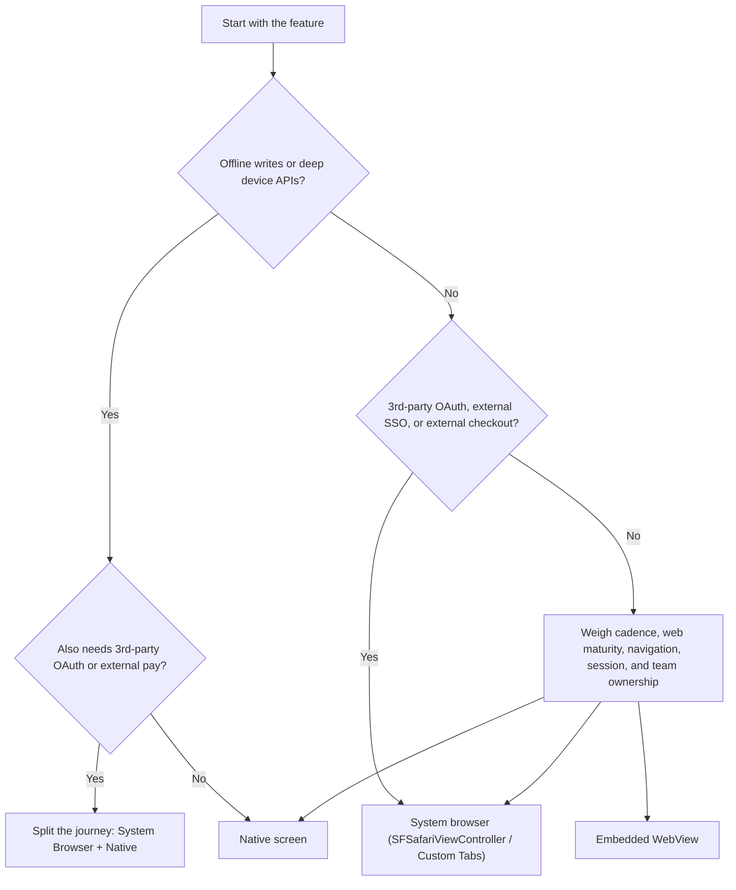

Sooner or later, every mobile team faces the same recurring debate. A new feature needs to ship inside an iOS and Android app—perhaps a help center, an account settings flow, a billing portal, or a field inspection form—and someone asks the inevitable question: *Can we just put this in a WebView?*

The question is rarely answered on technical merit alone. One camp remembers the last time an embedded web page broke keyboard scrolling, lost a user's session, or felt unmistakably foreign inside an otherwise crisp app, and argues that everything should be built natively. The other camp looks at a web team that already ships the same workflow daily, counts the cost of building and maintaining it twice more in Swift and Kotlin, and wonders why mobile engineering insists on reinventing a form that already exists.

Both instincts are pointing at real costs. The mistake is treating "WebView versus native" as an ideological preference—or as a binary choice at all. In practice, there are three distinct delivery options for any feature inside a mobile app: a **native screen**, an **embedded WebView** (`WKWebView` on iOS and `WebView` on Android), and the **system browser** (either an in-app browser tab via `SFSafariViewController` / Chrome Custom Tabs, or handing off to the default external browser).

Choosing well does not require guesswork. It requires evaluating the feature in order: first the user journey and ownership, then hard platform requirements, then the three-way trade-off across delivery options, and finally—if a WebView wins—drawing an explicit architectural boundary before writing a line of bridge code.

## 1. Start with the feature

Before comparing UI toolkits or rendering engines, pin down four facts about the feature itself:

- **The user journey.** Where does the user enter this screen, and what do they expect to happen when they finish or tap Back? A standalone document that users open once a quarter behaves very differently from a screen nested three levels deep inside a core tab.
- **Content and logic ownership.** Who actually owns the rules, copy, and layout when something needs to change? If legal, support, or a dedicated web squad owns the workflow, forcing every edit through two mobile codebases creates a permanent coordination tax.
- **Change cadence.** Does the feature evolve alongside quarterly app releases, or does it change daily in response to editorial updates, regional regulations, or A/B experiments? App store review cycles and slow user update tails turn frequent native changes into an operational drag.
- **Existing web maturity.** Does a production, mobile-ready web implementation already exist, or is this greenfield? Embedding a desktop-centric web page inside a WebView rarely saves time—you end up debugging responsive layout, viewport zoom, and touch targets inside two embedded engines instead of one browser.

These four questions establish your baseline. They tell you how much value you stand to gain from reusing the web. Next, you need to check whether hard platform requirements take that option off the table.

## 2. Identify hard requirements

Some constraints are negotiable trade-offs; others are architectural gates. Checking them early prevents teams from building an ambitious WebView prototype only to discover six weeks later that the platform cannot support it reliably.

### Offline behavior

Online-only features work everywhere. Cached read-only views can work in a WebView if you manage HTTP caching or bundled assets carefully, though iOS and Android can still evict WebView caches under storage pressure without warning. **Offline capture and reliable background sync**—where a user creates or edits records without connectivity and expects them to survive app restarts and sync later—strongly push you toward a native screen backed by durable local storage and OS-scheduled background work.

### Device capabilities

Standard file pickers, geolocation, and basic photo inputs are accessible from modern web views, albeit with subtly different permission flows on iOS and Android. Once a feature needs **deep hardware or OS integration**—Bluetooth Low Energy (BLE), NFC, biometric prompt orchestration, background location, custom camera pipelines, or home-screen widgets—an embedded WebView stops being a shortcut. You have to build and maintain native modules on both iOS and Android *and* design, version, and secure a JavaScript bridge between them. At that point, you are paying the dual-platform native cost while keeping web fragility.

### Interaction fidelity and accessibility

Document reading and standard forms play to the web platform's strengths. Fluid, gesture-driven interfaces—drag-and-drop canvases, complex shared-element transitions, 60–120fps scrolling feeds, or screens with intricate keyboard avoidance—expose the seams of an embedded WebView quickly.

Accessibility deserves equal scrutiny. Native controls inherit Dynamic Type, VoiceOver, TalkBack, focus order, and reduced-motion settings automatically. A WebView can be accessible, too, but only if the web content is authored with proper semantic HTML, ARIA landmarks, and text-scaling support—and tested inside both iOS VoiceOver and Android TalkBack, where focus transitions across the native-to-web boundary frequently break.

### The session and trust boundary

Authentication is where teams most often pick the wrong container. If the feature involves **third-party OAuth, external SSO, or an external payment provider**, an embedded WebView is an anti-pattern. Embedded WebViews do not share cookies or autofill state with the user's system browser, they hide or obscure the URL bar that users rely on to verify trust, and major identity providers actively block sign-ins from embedded WebViews in accordance with [RFC 8252](https://datatracker.ietf.org/doc/html/rfc8252). Those flows belong in the **system browser** (`SFSafariViewController` on iOS, Chrome Custom Tabs on Android).



## 3. Compare the three delivery options

When no single hard gate settles the question—or when you want to understand the runner-up—compare all three options across the operational dimensions that actually hurt six months after launch.

::: wide
| Dimension | Native screen | Embedded WebView | System browser |
| :--- | :--- | :--- | :--- |
| **Navigation & chrome** | Full native stack, gestures, tabs, and transitions. | Contained in-app frame; back stack and external links must be wired explicitly. | Standalone leave-and-return sheet with OS-controlled URL bar and Done button. |
| **Session & cookies** | Direct access to native tokens and secure storage. | Isolated cookie jar; requires explicit session handoff and expiry handling. | Shares system browser cookies and password managers; cannot read app tokens directly. |
| **Release cadence** | Bound to app store review and user update adoption. | Instant web deploys (subject to store policies on core functionality). | Instant web deploys with zero app release coupling. |
| **Platform ergonomics** | First-class scroll physics, haptics, Dynamic Type, and keyboard handling. | Good for documents and forms; seams show in gestures and keyboard resize. | Familiar browser ergonomics, autofill, Reader mode, and TLS trust indicators. |
| **Dual-platform maintenance** | Built and maintained twice (Swift + Kotlin) unless sharing UI cross-platform. | Single web UI, but native host wrapper, auth handoff, and bridge must be maintained on both OSes. | Minimal native code: launch URL and handle return deep link. |
| **When something breaks** | Mobile team owns crash reports, telemetry, and fixes. | Shared ownership: failures often sit in the seam between web code and native host. | Web team owns the page; mobile team only owns the launch and return contract. |
:::

Notice the column that gets overlooked most often: **the system browser**. Many teams reach for a WebView by default whenever they want to display web content, taking on cookie synchronization, custom back-button handling, TLS error screens, and memory overhead for a screen that could have been a five-line call to `SFSafariViewController` or Chrome Custom Tabs. If the user does not need your app's navigation chrome or an invisible in-app session handoff, the system browser is usually cleaner, safer, and cheaper to maintain than an embedded WebView.

## Try the framework

Use the evaluator below to test how different requirements and organizational constraints shift the recommendation across **Native screen**, **Embedded WebView**, and **System browser**. Start from one of the presets or adjust individual parameters to see what drives the verdict and what single change would flip it.

```widget ../../widgets/webview-vs-native.js layout=wide
{"preset":"help-center","title":"WebView vs. Native Decision Evaluator"}
---
**Interactive evaluator (static summary).** Evaluate a feature across nine parameters split into two groups:

- **Hard requirements:** offline behavior (*online only*, *cached reads*, *offline capture & sync*), device capabilities (*none*, *basic*, *deep hardware/OS*), interaction fidelity (*document*, *forms & lists*, *fluid 60fps+ gestures*), and session/auth boundary (*public*, *app session*, *3rd-party OAuth / checkout*).
- **Feature & team context:** change cadence (*with app releases*, *monthly*, *daily / editorial*), existing web flow (*greenfield*, *partial*, *mobile-ready*), role in the user journey (*peripheral*, *secondary*, *core loop*), navigation integration (*leave & return*, *in-app frame*, *deep native stack*), and team ownership (*web-owned*, *shared*, *dedicated iOS & Android*).

**Decision rules:** Offline writes or deep device APIs gate the decision toward a **Native screen**. Third-party OAuth or external checkout gates toward the **System browser** (if both apply, split the journey across the two hosts). When no hard gate dominates, continuous updates, an existing mobile-ready web flow, contained navigation, and web-team ownership favor an **Embedded WebView**—provided you explicitly own the navigation, authentication, and bridge boundaries.
```

## 4. Draw the boundary

When an embedded WebView is the right call, most long-term pain comes not from the web view itself, but from a blurry or implicit boundary between the native host and the web application. Before shipping, make three contracts explicit.

### Navigation ownership

Decide upfront which links stay inside the WebView, which routes trigger native screens, and which external URLs escape to the system browser. Implement an explicit allowlist of hosts permitted inside the WebView. Wire the native back button (and Android's predictive back gesture) to check WebView history first and pop the native screen cleanly when history is empty. Finally, design native loading, timeout, and offline error states—never leave a user staring at a raw browser `ERR_NAME_NOT_RESOLVED` page.

### Authentication and session lifecycle

If the WebView needs an authenticated session, treat session handoff as a first-class protocol rather than an afterthought. Avoid passing long-lived bearer tokens in URL query strings where they leak into server logs, referrer headers, and browser history. Prefer short-lived, single-use session exchange tokens or scoped HTTP-only cookies injected into the WebView's cookie store before navigation—and define what happens when a session expires mid-flow (re-authenticate natively and reload) and when the user logs out (clear the WebView's cookies, `localStorage`, and caches on both platforms).

### The JavaScript bridge

Keep the bridge surface as small as possible, ideally zero. Every native method exposed to JavaScript (`WKScriptMessageHandler` on iOS, `@JavascriptInterface` on Android) becomes a versioned API that must remain backward-compatible with older app binaries still in the field.

::: warning Restrict bridge origins
Never expose privileged native bridge methods to arbitrary origins. Validate the sender's exact HTTPS origin on every message, reject untrusted frames, and treat all payloads crossing from JavaScript to native code as untrusted input.
:::

## 5. Work through two cases

Abstract frameworks are only useful if they give clear, falsifiable answers on real features. Let's run two concrete scenarios through the same questions.

### Case 1: A frequently updated help center and policy hub

- **Feature:** Contextual help articles, troubleshooting guides, and regional terms of service. Owned by the support and legal teams, edited several times a week, and already published as a fast, mobile-responsive web portal.
- **Hard requirements:** Online-only is acceptable (with a simple native offline notice). No device APIs beyond standard text rendering. Document-centric reading. Users are already signed in to the app, and personalized support articles (or pre-filled ticket forms) benefit from knowing the user's account context.
- **Decision:** **Embedded WebView** (with **System browser** as a close runner-up). Continuous editorial updates, an existing mobile-ready web surface, and web-team ownership make dual native screens a poor investment. Keeping it in a contained WebView lets the user stay inside the app frame and carry their authenticated account context into support articles without signing in again.
- **Boundary to draw:** Allowlist only the help center domain inside the WebView; route outbound links to the system browser; exchange a short-lived token for a scoped session cookie; keep the JS bridge empty (or limited to a single "open native support chat" deep link).
- **What would flip it:** If the help articles were completely public and needed no account context, **System browser** would win—eliminating WebView cookie and error-state maintenance altogether. Conversely, if users needed guaranteed offline access to troubleshooting manuals in airplanes or basements, you would move to a **Native screen** (or bundle versioned local content natively).

### Case 2: An offline field capture workflow

- **Feature:** Technicians inspecting equipment in utility rooms and rural sites. They scan an asset tag, capture annotated photos, fill out a structured checklist, and submit the report. The flow is the core daily loop of the app, changes only a few times a year, and does not exist on the web.
- **Hard requirements:** **Offline capture and durable background sync** are non-negotiable—technicians routinely lose signal mid-inspection. The workflow requires **deep device capabilities** (NFC/barcode scanning, custom camera annotation, GPS tagging, and reliable background upload queues) and **fluid interaction fidelity** for rapid one-handed data entry.
- **Decision:** **Native screen**, decisively. Both offline writes and deep device APIs act as hard gates. Attempting to build this inside a WebView would mean writing native NFC, camera, local database, and background sync modules on both iOS and Android anyway, then gluing them to a web UI through a fragile, high-bandwidth JavaScript bridge.
- **What would flip it:** Only removing the hard gates would change the answer. If connectivity were guaranteed, hardware needs dropped to a standard HTML file input, and an existing mobile web form were already maintained by another team, an embedded WebView would become viable—though even then, a core daily workflow often justifies native ergonomics.

---

The goal of this framework is not to declare native always better or WebViews always expedient. It is to replace vague architectural instinct with a shared vocabulary. When a team can point to the exact requirement that drove a choice—and name the exact condition that would change it—the debate stops being about taste and becomes engineering.
